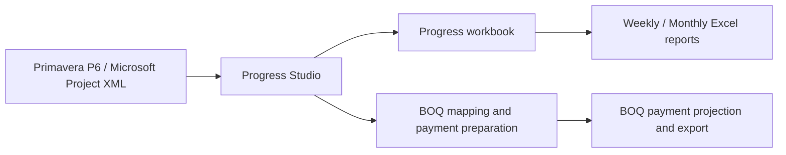

<p align="center">
  
</p>

<h1 align="center">Progress Studio</h1>
<p align="center"><strong>Plan in P6 or MSP. Report progress in Excel.</strong></p>
<p align="center">Construction progress reporting · BOQ mapping · Payment requirements · S-curves</p>

<p align="center">
  <a href="#workflow">Workflow</a> ·
  <a href="#capabilities">Capabilities</a> ·
  <a href="#quick-start">Quick start</a> ·
  <a href="docs/README.md">Documentation</a> ·
  <a href="docs/ROADMAP.md">Project status</a>
</p>

---

## From construction schedule to useful reporting

Planning teams work in **Oracle Primavera P6** or **Microsoft Project**, but progress reviews often happen in **Excel**. Progress Studio connects those workflows so teams can spend less time rebuilding reporting workbooks by hand.

It is a **desktop application for construction reporting**, not a replacement scheduling system, certified-payment system, or accounting platform.

## Workflow



1. **Create:** import a P6/MSP XML schedule, choose a weighting basis, weekly cutoff, and plan distribution, then generate a Progress workbook.
2. **Update:** enter actual progress in editable Excel cells; use **F9 and Save** to recalculate. Optionally map BOQ amounts, prepare Payment Input, or prepare manual BOQ requirements.
3. **Report:** refresh generated views using **Rebuild**, or export separate BOQ payment reports from the reviewed payment workflow.

> **Important:** Excel recalculation is not the same as a Python Rebuild. Snapshot reports must be refreshed using their owning operation. BOQ payment projections are planning/reporting outputs, **not certified payments**.

## Capabilities

| Area | What it provides |
| --- | --- |
| **Progress & S-curves** | Weekly/monthly Plan and Actual, dashboard, progress views, and a compact weekly presentation. |
| **Weight selection** | Equal, Duration, or selected Amount; Amount is not assumed to be money without appropriate source evidence. |
| **BOQ Mapping** | Allocate BOQ item amounts to schedule activities with saved mapping shares. |
| **Payment Input** | Prepare activity payment requirements and Amount-weighted WBS rollups. |
| **BOQ Payment Projection** | Project mapped activity requirements to BOQ items with explicit coverage and diagnostics. |
| **BOQ Payment Export** | Generate a separate Excel report with Percentage, Amount, Trace, and protected snapshot data. |
| **Manual BOQ Requirements** | Prepare, save, and include manually entered BOQ requirements alongside activity-mapped requirements, with origin separation. |
| **Earned Value** | Live EV reporting using Activity Amount or BOQ Mapping monetary sources. |
| **P6 XML Amount Writeback** | Reviewed export of selected workbook Amounts to a separate P6 XML file; source files are preserved. |
| **ENG / THA desktop UI** | Select interface language; changes take effect on next application launch. Workbook formulas and sheet identities remain unchanged. |

### Payment workflow

**Prepare BOQ Requirements → Edit and Save BOQ Requirement Input in Excel → Export BOQ Payment Workbook**

The exported BOQ payment workbook is a **separate report**. It is not a replacement for the source BOQ or the Payment Input workbook. See [manual requirements](docs/BOQ_MANUAL_REQUIREMENTS.md), [payment projection](docs/BOQ_PAYMENT_PROJECTION.md), and [payment export](docs/BOQ_PAYMENT_EXPORT.md).

## Quick start

**Windows desktop:** for an existing authorized portable distribution, extract the complete folder and run `ProgressStudio.exe`. If using an installer, follow its installation wizard. **This README does not claim a new public release or offer an unverified download.**

**Run from source** (Python 3.10+ with Tkinter):

```powershell
python -m venv .venv
.\.venv\Scripts\Activate.ps1
python -m pip install -e ".[dev]"
python desktop.py
```

See the [Windows build guide](packaging/windows/WINDOWS_BUILD_GUIDE.md) for building distribution artifacts.

## Documentation

| I want to… | Start here |
| --- | --- |
| Create and update a workbook | [User workflow](docs/USER_WORKFLOW.md) |
| Understand weighting and Earned Value | [Weight selection](docs/WEIGHT_SELECTION.md) · [EV monetary sources](docs/EV_MONETARY_SOURCES.md) |
| Work with BOQ payment reports | [BOQ projection](docs/BOQ_PAYMENT_PROJECTION.md) · [BOQ export](docs/BOQ_PAYMENT_EXPORT.md) · [Manual requirements](docs/BOQ_MANUAL_REQUIREMENTS.md) |
| Write Amounts back to P6 XML | [P6 XML writeback](docs/XML_AMOUNT_WRITEBACK.md) |
| Find project status and open work | [Roadmap](docs/ROADMAP.md) · [Next steps](docs/NEXT_STEPS.md) |
| Develop or verify the application | [Development](docs/DEVELOPMENT.md) · [Testing](docs/TESTING.md) · [Architecture](docs/ARCHITECTURE.md) |

Browse the full [documentation index](docs/README.md) or [Changelog](CHANGELOG.md).

## Project status and boundaries

Accepted source milestones include Progress Studio V1/V1.1, Weekly Compact, BOQ Update, XML writeback, Payment Input, and BP-1 through BP-4. See the [Roadmap](docs/ROADMAP.md) for milestone-level status and deferred investigations.

- **XW-DP (two-decimal XML writeback)** is a separately authorized investigation/implementation task; **not claimed as shipped here**.
- Mini Gantt was **cancelled**. Finance code remains available for compatibility but is hidden from normal V1.1 navigation.
- This repository's source milestones do not establish that a new installer or signed public release has been published.

## Development and tests

```powershell
python -m pytest -q
```

See [Engineering workflow](docs/ENGINEER_WORKFLOW.md) and [Release checklist](docs/RELEASE_CHECKLIST.md). No new release version is asserted by this documentation refresh.
